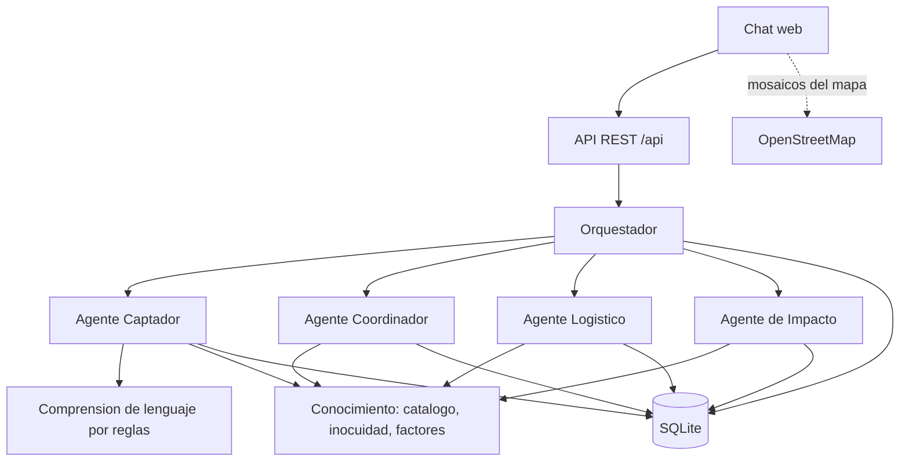
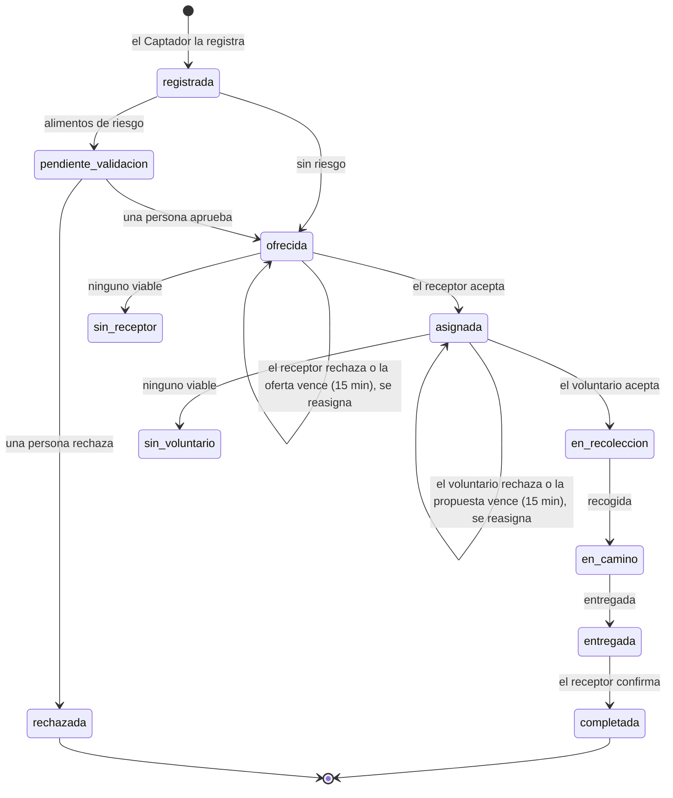
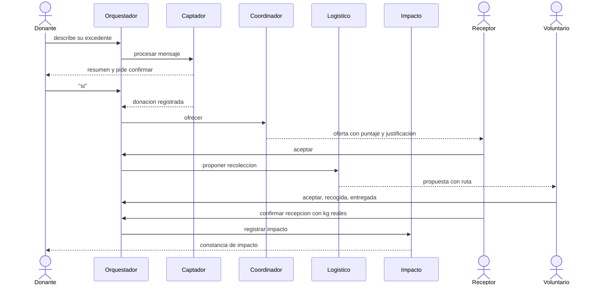
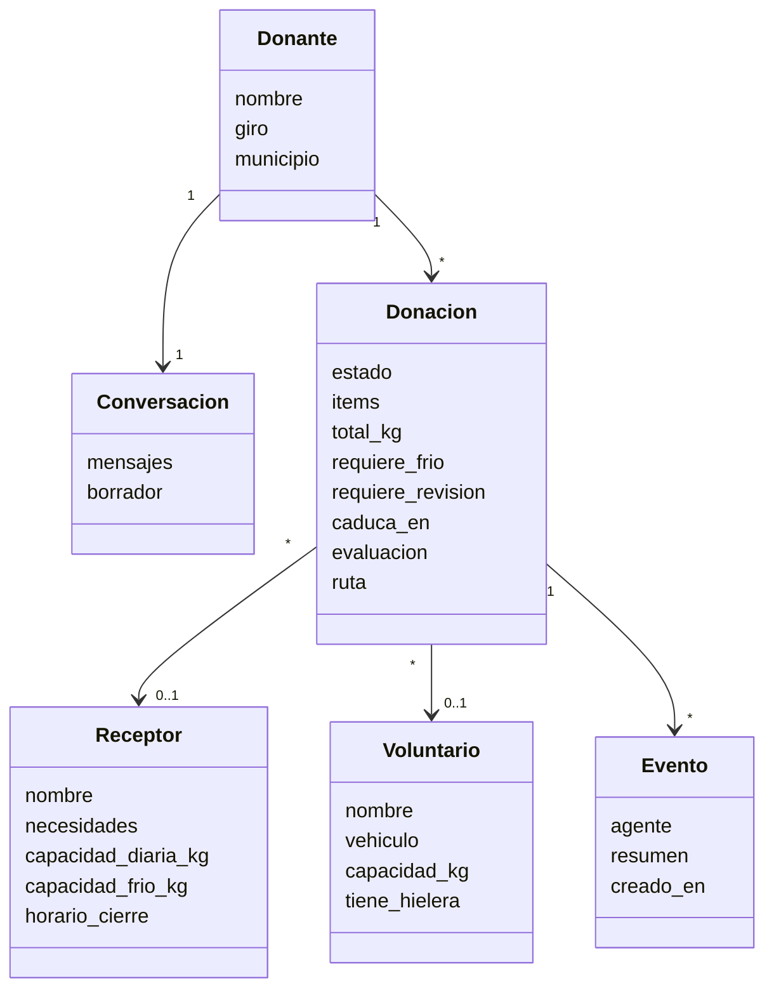

# Arquitectura

Borradores en Mermaid (GitHub los dibuja) para los diagramas de la entrega del 24 de noviembre. Reflejan el código.

## Componentes

Los cuatro agentes y el orquestador son componentes separados. Los agentes **no se llaman entre sí**: el orquestador decide
quién actúa según el estado de la donación.

| Componente | Módulo |
|---|---|
| Orquestador | `comparte/orquestador.py` |
| Agentes | `comparte/agentes/` (`captador`, `coordinador`, `logistico`, `impacto`) |
| Comprensión de lenguaje | `comparte/nlu.py` |
| Catálogo, inocuidad, factores y distancias | `comparte/conocimiento.py` |
| API | `comparte/api.py` |
| Modelo de datos | `comparte/modelos.py` |
| Interfaz | `web/` |

## Estados de una donación

Cada flecha es un cambio **atómico**: `UPDATE donaciones SET estado = :nuevo WHERE id = :id AND estado = :esperado`
(`agentes/base.py`, `transicionar`). Si la donación ya cambió (doble clic, dos pestañas, oferta vencida), el `UPDATE` no
afecta ninguna fila y la API responde 409. Las ofertas (`oferta_vence_en`) y las propuestas a voluntarios
(`propuesta_vence_en`) vencen a los 15 minutos; mientras están vencidas ya no apartan capacidad ni voluntario, y
`Orquestador.expirar_vencidas()` las pasa al siguiente candidato (se ejecuta al inicio de cada operación que cambia el estado).

## Secuencia del rescate

## Clases del dominio

## Decisiones de diseño

| Decisión | Razón | Costo |
|---|---|---|
| Canal web primero | La API de WhatsApp Business puede ser costosa (retroalimentación del profesor) | WhatsApp requeriría un adaptador |
| Agentes con reglas, sin LLM | Gratis, reproducible y probable; alcanza para dos semanas | Entiende un subconjunto del español; **el paso siguiente es un LLM en `nlu.py`** |
| Orquestador central | Cada agente es independiente y testeable; un solo lugar para el flujo | El orquestador concentra la lógica de flujo |
| Decisiones explicables | El ranking, los motivos de descarte y la bitácora quedan guardados | Más datos por donación |
| Supervisión humana en riesgo | Restricción ética del documento de visión | Una persona es cuello de botella |
| Reloj controlable | Pruebas deterministas y demo a cualquier hora | Usar `reloj.ahora()`, no `datetime.now()` |
| Transiciones atómicas (`UPDATE ... WHERE estado = :esperado`) | Con un doble clic la donación avanzaba dos veces y el impacto se podía registrar doble (retroalimentación del profesor) | Toda transición pasa por `transicionar`; solo quien gana el `UPDATE` escribe eventos y avisos |
| Ofertas y propuestas con tiempo límite (15 min) | Una oferta sin respuesta apartaba la capacidad del receptor para siempre | Columnas nuevas: una base creada antes requiere `--reiniciar` |
| Bloqueo optimista en la conversación (`Conversacion.version`) | Un doble "sí" podía registrar la donación dos veces | El segundo mensaje recibe un 409 y hay que reenviarlo |

## Pendientes (siguiente ciclo)

LLM en el Captador (y fotos), autenticación por roles (los métodos del orquestador ya aceptan `receptor_id` y
`voluntario_id` para verificar quién responde), alta y verificación de
receptores, equidad en la asignación, API de mapas, PostgreSQL, validación con un banco de alimentos real y los UML finales.
