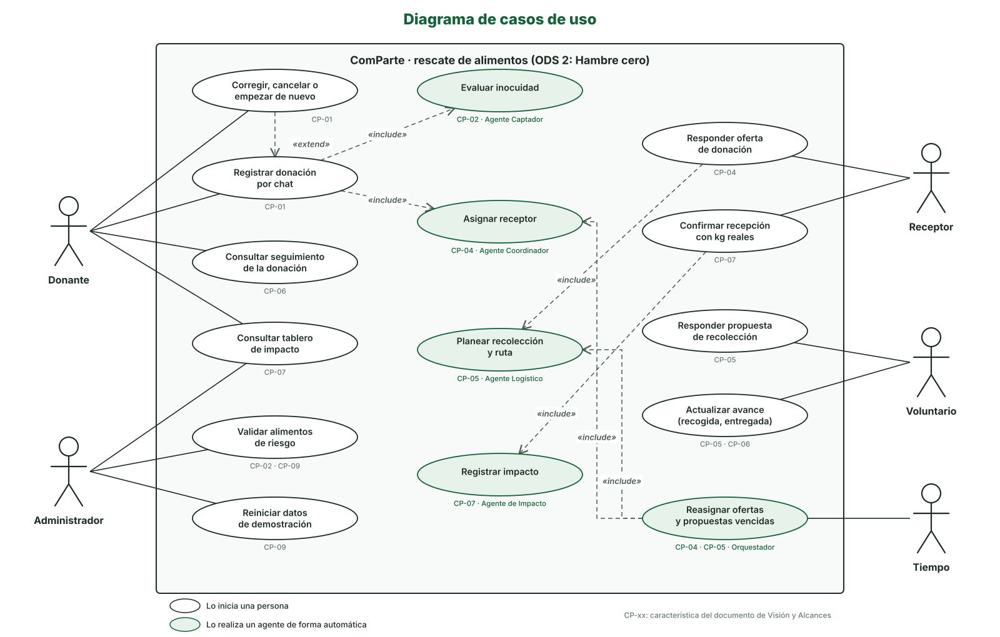
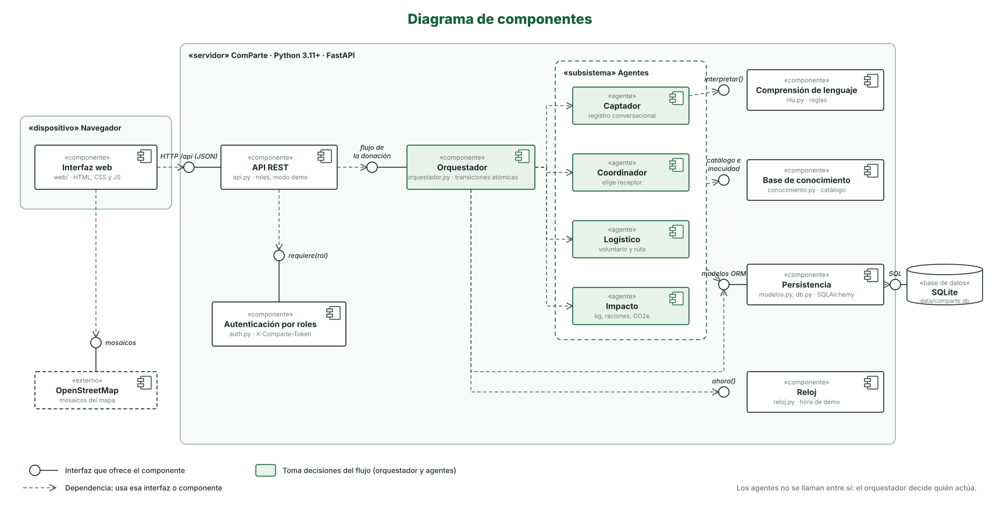
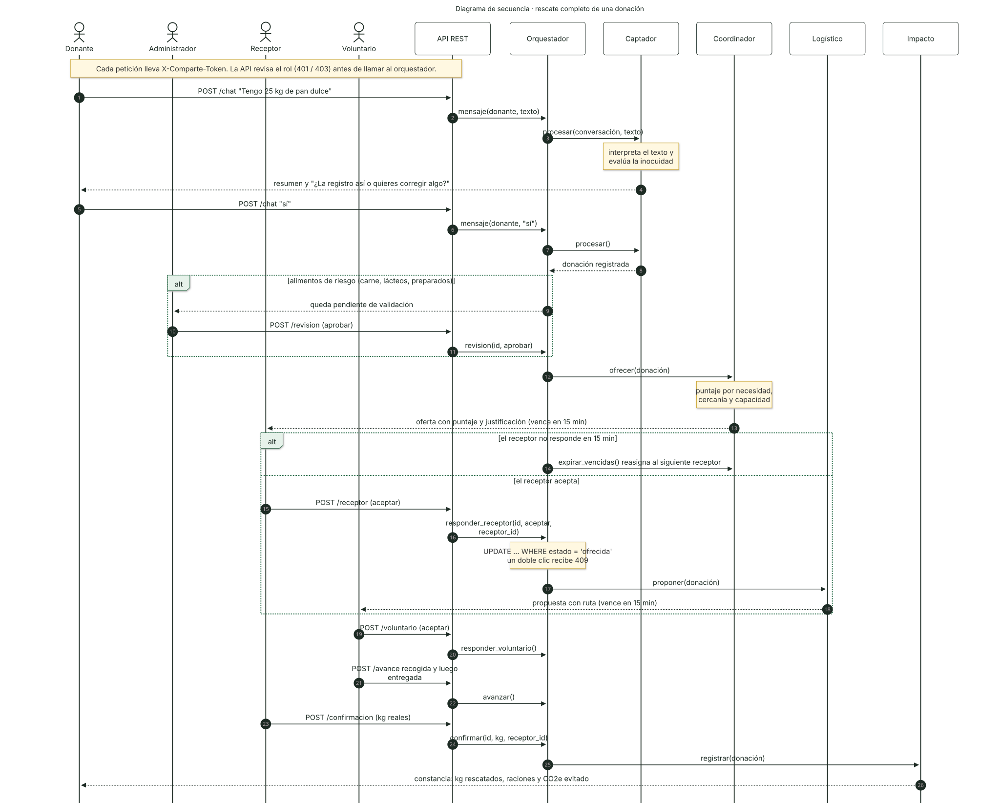

# Diagramas de diseño UML

Los cuatro diagramas que piden las bases del hackathon, hechos a partir del código de este repositorio. Cada uno tiene su
imagen en SVG (se ve en GitHub y se puede ampliar sin perder calidad) y en PNG (para pegar en documentos o en el video), en
[`docs/diagramas/`](diagramas/).

| Diagrama | Qué muestra | Imagen | Fuente |
|---|---|---|---|
| [Casos de uso](#1-diagrama-de-casos-de-uso) | Quién usa ComParte y para qué | [SVG](diagramas/casos_de_uso.svg) · [PNG](diagramas/casos_de_uso.png) | [`casos_de_uso.py`](diagramas/casos_de_uso.py) |
| [Componentes](#2-diagrama-de-componentes) | Las piezas del sistema y sus interfaces | [SVG](diagramas/componentes.svg) · [PNG](diagramas/componentes.png) | [`componentes.py`](diagramas/componentes.py) |
| [Clases](#3-diagrama-de-clases) | Modelo de datos, agentes y servicios | [SVG](diagramas/clases.svg) · [PNG](diagramas/clases.png) | [`clases.mmd`](diagramas/clases.mmd) |
| [Secuencia](#4-diagrama-de-secuencia) | Un rescate completo, mensaje por mensaje | [SVG](diagramas/secuencia.svg) · [PNG](diagramas/secuencia.png) | [`secuencia.mmd`](diagramas/secuencia.mmd) |

El diagrama de estados de una donación está en [`ARQUITECTURA.md`](ARQUITECTURA.md#estados-de-una-donación).

---

## 1. Diagrama de casos de uso



- **Cuatro actores humanos**: el donante, el receptor (comedor, albergue, banco de alimentos), el voluntario y el
  administrador. Un quinto actor, el **Tiempo**, dispara la reasignación de las ofertas y propuestas que vencen a los 15 min.
- **Casos de uso en verde**: los realiza un agente de forma automática, sin que nadie apriete un botón. Ahí está lo
  *agéntico* de la solución: el Captador evalúa la inocuidad, el Coordinador elige receptor, el Logístico arma la recolección
  y el agente de Impacto mide el rescate.
- **«include»**: registrar una donación siempre evalúa su inocuidad y busca receptor; aceptar una oferta siempre planea la
  recolección; confirmar la recepción siempre registra el impacto. **«extend»**: corregir, cancelar o empezar de nuevo es
  opcional durante el registro.
- Cada caso de uso indica la característica (CP-xx) del documento de Visión y Alcances que cubre. El detalle de hasta dónde
  llega cada una está en [`ALCANCE.md`](ALCANCE.md).

## 2. Diagrama de componentes



- **Navegador**: la interfaz web (HTML, CSS y JavaScript sin compilación) solo habla con la API por HTTP y JSON.
- **API REST** (`api.py`): recibe las peticiones y revisa el rol de quien la hace con la interfaz `requiere(rol)` del
  componente de **Autenticación** (`auth.py`). Después le pasa la acción al orquestador.
- **Orquestador** (`orquestador.py`): decide qué agente actúa según el estado de la donación. Cada cambio de estado es
  atómico (`UPDATE ... WHERE estado = :esperado`), así que un doble clic no puede avanzar la donación dos veces.
- **Subsistema de agentes**: Captador, Coordinador, Logístico e Impacto. **No se llaman entre sí**; todos usan la base de
  conocimiento (catálogo de alimentos, reglas de inocuidad, distancias) y la persistencia.
- **Servicios**: comprensión de lenguaje por reglas (`nlu.py`, se puede cambiar por un LLM sin tocar al Captador), reloj
  controlable para pruebas y demo, y persistencia con SQLAlchemy sobre SQLite.

## 3. Diagrama de clases



- **Dominio** (`modelos.py`): `Donacion` es la clase central. Guarda su `Estado`, a qué `Receptor` y `Voluntario` se asignó,
  quién la rechazó, cuándo vence la oferta y su bitácora de `Evento`s (cada decisión de un agente deja uno).
  `Conversacion.version` es el bloqueo optimista que evita registrar dos veces con un doble "sí".
- **Agentes**: el `Orquestador` expone las operaciones que llama la API. El Coordinador y el Logístico tienen la vigencia de
  15 min de las ofertas y las propuestas.
- **Servicios**: `Interpretacion` e `ItemDicho` son lo que el Captador entiende de un mensaje; `Alimento` es una entrada del
  catálogo; `Evaluacion` es el resultado de las reglas de inocuidad.

## 4. Diagrama de secuencia



El rescate de punta a punta: el donante describe su excedente y confirma, un administrador valida si hay alimentos de
riesgo, el Coordinador ofrece la donación al receptor con más puntaje, el Logístico propone voluntario y ruta, el voluntario
recoge y entrega, el receptor confirma los kg reales y el agente de Impacto le manda al donante su constancia.
Los dos bloques `alt` muestran las ramas: alimentos de riesgo y una oferta que vence sin respuesta.

---

## Cómo regenerarlos

Si cambia el código, actualiza la fuente y vuelve a generar la imagen:

```bash
python docs/diagramas/casos_de_uso.py        # casos_de_uso.svg (solo biblioteca estándar)
python docs/diagramas/componentes.py         # componentes.svg
npx -p @mermaid-js/mermaid-cli mmdc -i docs/diagramas/clases.mmd -o docs/diagramas/clases.svg
npx -p @mermaid-js/mermaid-cli mmdc -i docs/diagramas/secuencia.mmd -o docs/diagramas/secuencia.svg
```

Los PNG se exportan de los SVG (por ejemplo, abriéndolos en el navegador o con `rsvg-convert -z 2`).
